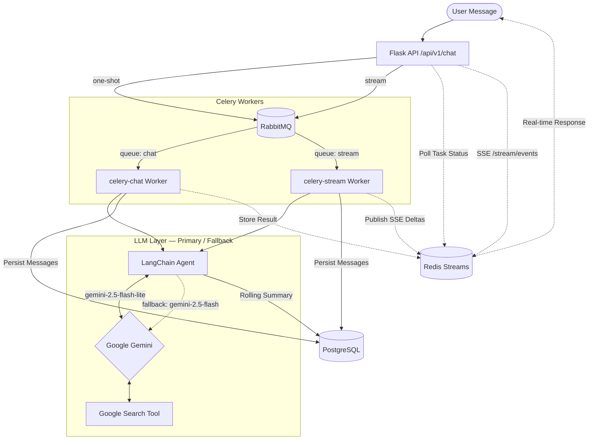
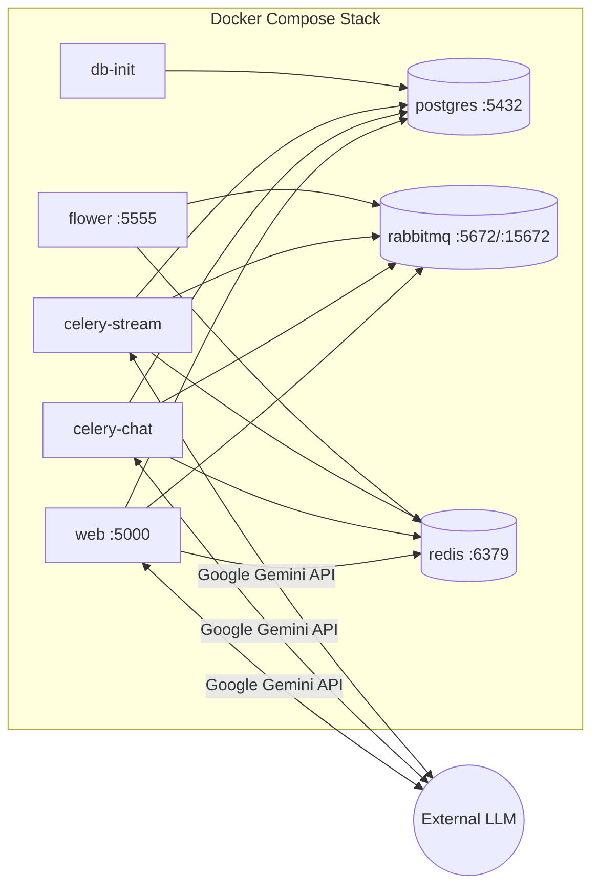

# 🐑 Sheep Chatbot

An AI-powered chatbot specializing in sheep farming, livestock care, and general knowledge. Built with Flask, LangChain, Google Gemini, and a fully asynchronous task pipeline using Celery, RabbitMQ, and Redis.

---

## 🏗️ Architecture

### System Flow



---

### Service Architecture



---

## 🏢 Infrastructure

### Services Overview

| Service          | Port(s)      | Description                                     |
| ---------------- | ------------ | ----------------------------------------------- |
| `web`            | 5000         | Flask API server (Gunicorn in production)        |
| `postgres`       | 5432         | PostgreSQL 16 — persistent chat & user storage   |
| `rabbitmq`       | 5672 / 15672 | Message broker + management UI                   |
| `redis`          | 6379         | Celery result backend & SSE stream state store   |
| `celery-chat`    | —            | Celery worker consuming the `chat` queue         |
| `celery-stream`  | —            | Celery worker consuming the `stream` queue       |
| `flower`         | 5555         | Celery task monitoring dashboard                 |
| `db-init`        | —            | One-shot container that bootstraps the database  |

---

## 📡 API Endpoints

All chat endpoints are mounted under `/api/v1/chat`.

### Chat

| Endpoint                           | Method | Description                                        |
| ---------------------------------- | ------ | -------------------------------------------------- |
| `/api/v1/chat/`                    | GET    | Chat service health check                          |
| `/api/v1/chat/ui`                  | GET    | Built-in web chat interface                        |
| `/api/v1/chat/one-shot`            | POST   | Queue a one-shot chat message (async via Celery)   |
| `/api/v1/chat/tasks/<task_id>`     | GET    | Poll status / result of a one-shot task            |

### Streaming

| Endpoint                                | Method | Description                                        |
| --------------------------------------- | ------ | -------------------------------------------------- |
| `/api/v1/chat/stream`                   | POST   | Direct SSE streaming response                      |
| `/api/v1/chat/stream/start`             | POST   | Start async streaming run (returns `run_id`)       |
| `/api/v1/chat/stream/events/<run_id>`   | GET    | Consume SSE events for a streaming run             |
| `/api/v1/chat/stream/status/<run_id>`   | GET    | Poll lifecycle status of a streaming run           |
| `/api/v1/chat/stream/cancel/<run_id>`   | POST   | Request cancellation of an active stream           |

### Threads & History

| Endpoint                                       | Method | Description                                   |
| ---------------------------------------------- | ------ | --------------------------------------------- |
| `/api/v1/chat/threads`                         | GET    | List user's conversation threads (paginated)  |
| `/api/v1/chat/threads/<thread_id>/history`     | GET    | Get message history for a thread (paginated)  |

---

## 🗂️ Project Structure

```text
├── app/
│   ├── __init__.py         # Flask application factory & Swagger config
│   ├── celery_app.py       # Celery app factory, queue routing & signal hooks
│   ├── logger.py           # Application logger
│   ├── agents/
│   │   └── agent.py        # LangChain agent — LLM invocation, streaming,
│   │                       #   primary/fallback logic, rolling summary compaction
│   ├── auth/               # Authentication & authorization
│   ├── config/             # Application configuration (env-driven)
│   ├── core/
│   │   └── logging_config.py  # Structured logging, request-id correlation
│   ├── db/
│   │   ├── database.py     # SQLAlchemy engine & session factory
│   │   ├── models.py       # ORM models: User, Thread, ThreadMessage, ThreadSummary
│   │   ├── repository.py   # Data access layer (CRUD queries)
│   │   └── bootstrap.py    # Database initialization & seed data
│   ├── routes/
│   │   ├── chat.py         # All REST & SSE endpoint definitions
│   │   └── chat_helpers.py # Request parsing & pagination utilities
│   ├── services/
│   │   ├── agent.py        # Service layer — thread management & history retrieval
│   │   ├── stream_service.py  # Redis Streams SSE event publishing & lifecycle
│   │   └── redis_client.py # Shared Redis connection pool (singleton)
│   ├── tasks/
│   │   ├── chat_tasks.py       # Celery task: one-shot chat processing
│   │   └── chat_stream_task.py # Celery task: streaming chat with Redis events
│   ├── templates/          # Jinja2 HTML templates (chat UI)
│   ├── static/             # Static assets (CSS, JS)
│   └── utils/              # General utilities (SSE formatting, etc.)
├── cli/                    # CLI tools & helper scripts
├── tests/                  # Test suite
├── .env.example            # Environment variable template
├── Dockerfile              # Python 3.11 application image
├── docker-compose.yml      # Development stack
├── docker-compose.prod.yml # Production stack (optimized)
├── requirements.txt        # Python dependencies
└── run.py                  # Development entry point (Flask dev server)
```

---

## ⚙️ Prerequisites

- [Docker](https://docs.docker.com/get-docker/) & [Docker Compose](https://docs.docker.com/compose/install/)
- A **Google API Key** with access to Gemini models

---

## 🚀 Setup & Installation

**1. Clone the repository**

```bash
git clone <repository_url>
cd <repository_directory>
```

**2. Configure environment**

```bash
cp .env.example .env
```

Edit `.env` and set at minimum:

| Variable         | Required | Description                          |
| ---------------- | -------- | ------------------------------------ |
| `GOOGLE_API_KEY` | ✅        | Google Gemini API key                |
| `POSTGRES_DB`    | —        | Database name (default: `sheep_chatbot`) |
| `POSTGRES_USER`  | —        | DB user (default: `postgres`)        |
| `POSTGRES_PASSWORD` | —     | DB password (default: `postgres`)    |

> All other variables have sensible defaults for local development. See `.env.example` for the full list.

**3. Build and start**

```bash
docker-compose up --build -d
```

The `db-init` container will automatically create tables and seed the default user on first run.

**4. Verify**

```bash
curl http://localhost:5000/
# → {"status": "success", "message": "The application works properly.", "data": null}
```

---

## 📚 API Documentation (Swagger)

Interactive API documentation is auto-generated via [Flasgger](https://github.com/flasgger/flasgger):

- **Swagger UI:** [http://localhost:5000/apidocs/](http://localhost:5000/apidocs/)
- **OpenAPI Spec:** [http://localhost:5000/apispec.json](http://localhost:5000/apispec.json)

---

## 📊 Monitoring & Observability

| Dashboard             | URL                                             | Description                    |
| --------------------- | ----------------------------------------------- | ------------------------------ |
| **RabbitMQ Management** | [http://localhost:15672](http://localhost:15672) | Queue depths, connections, exchanges |
| **Flower**            | [http://localhost:5555](http://localhost:5555)   | Celery task monitoring & history |
| **Swagger UI**        | [http://localhost:5000/apidocs/](http://localhost:5000/apidocs/) | Interactive API explorer       |

Default RabbitMQ credentials: `guest` / `guest` (configurable via `.env`).

---

## 🧠 Key Design Decisions

- **Primary / Fallback LLM:** Every request tries `gemini-2.5-flash-lite` first, then falls back to `gemini-2.5-flash` on failure — balancing cost and reliability.
- **Rolling Summary Compaction:** Long conversations are periodically summarized to keep the context window within LLM token limits while preserving conversational memory.
- **Dual Celery Queues:** `chat` (one-shot) and `stream` (SSE) queues are isolated so streaming workloads don't block simple chat requests.
- **Redis Streams for SSE:** Streaming responses are published to Redis Streams, enabling reconnectable SSE with `Last-Event-ID` support and automatic TTL cleanup.
- **Google Search Grounding:** The LLM is bound with Google Search as a tool, allowing it to ground answers in real-time web results.
